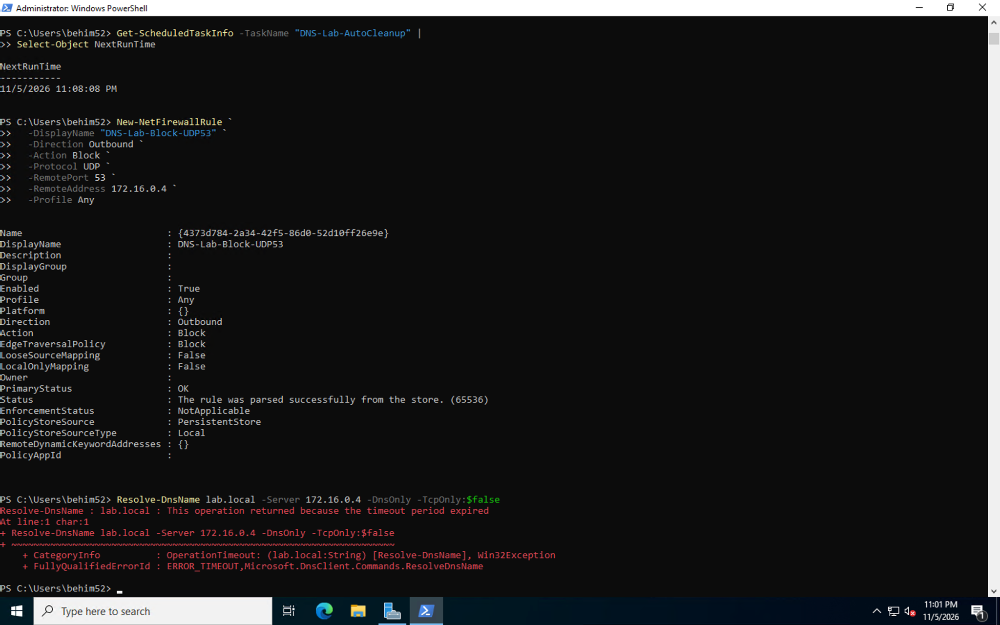
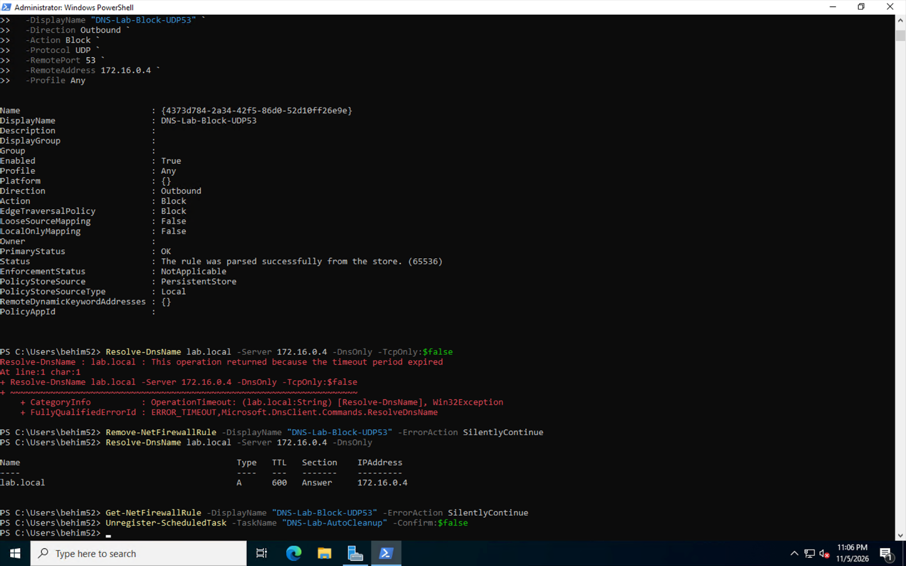
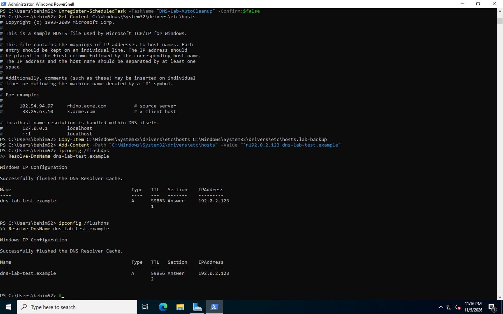
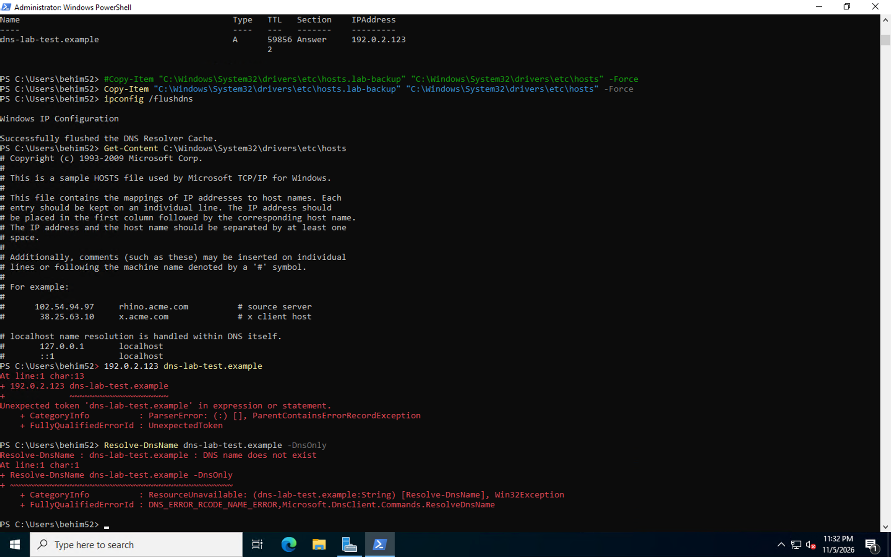
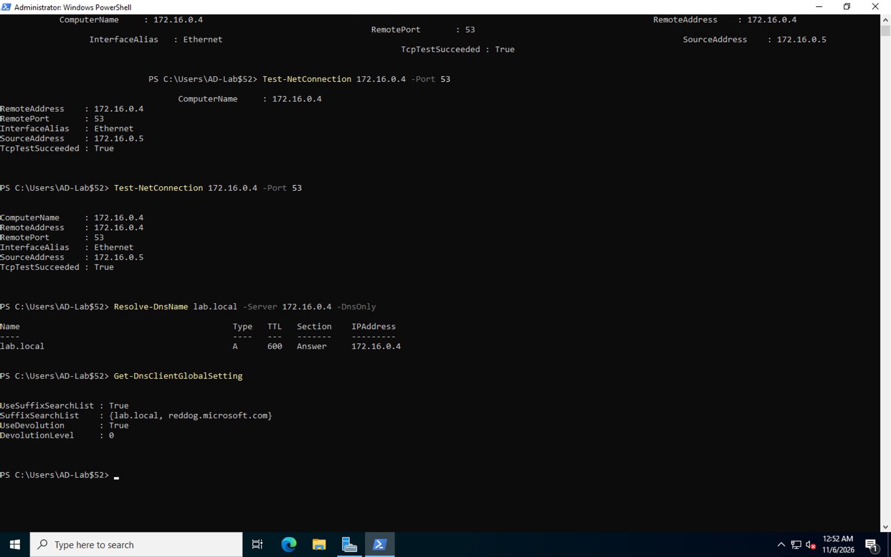
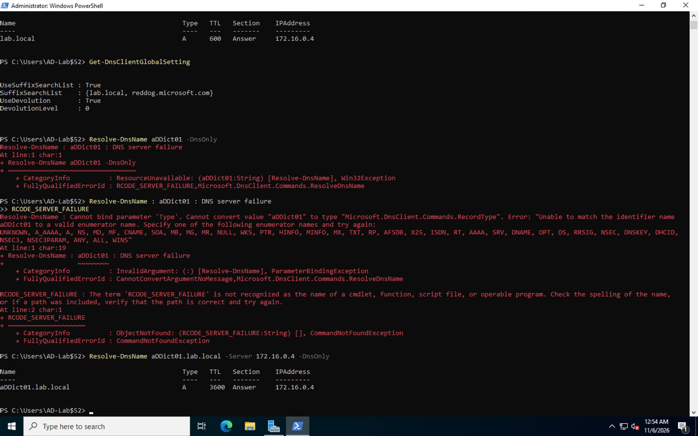
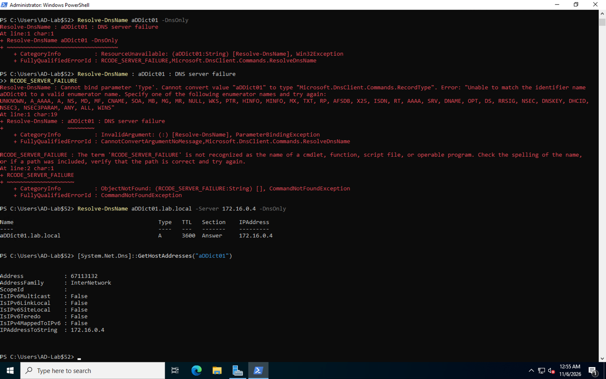
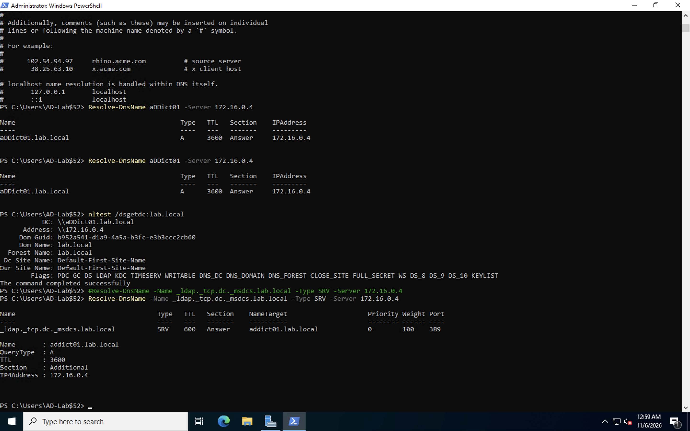

# Windows DNS & Active Directory Troubleshooting Lab

## Project Overview

I completed this hands-on lab to improve my Windows troubleshooting and networking skills.

Using Windows virtual machines hosted in Microsoft Azure, I simulated DNS failures, investigated connectivity issues, and practiced resolving problems using PowerShell.

My goal was to gain practical experience troubleshooting the types of issues that come up in IT Help Desk, Desktop Support, and System Administration environments.

## Technologies Used

- Windows Server & Windows Client
- Active Directory Domain Services (AD DS)
- Microsoft Azure
- PowerShell
- DNS & TCP/IP Networking
- Windows Firewall

## Lab Environment

| Component | Configuration |
|---|---|
| Domain | lab.local |
| Domain Controller | aDDict01.lab.local |
| DNS Server | 172.16.0.4 |
| Windows Client | 172.16.0.5 |
| Platform | Microsoft Azure |

## Troubleshooting Scenarios

### 1. DNS Failure & Firewall Troubleshooting

I created a Windows Firewall rule blocking outbound UDP traffic on port 53 to simulate a DNS failure.

After applying the rule, DNS queries timed out. I removed the firewall rule and tested again to confirm DNS resolution was restored.

**Result:** Identified and resolved a DNS connectivity issue caused by a firewall restriction.

**DNS Failure**

**DNS Resolution Restored**

### 2. Windows Hosts File Troubleshooting

I backed up and modified the Windows hosts file to test local hostname resolution.

I added a temporary hostname mapping, flushed the DNS cache, and verified the results using PowerShell. After testing, I restored the original hosts file.

**Result:** Verified how local hostname mappings affect Windows name resolution.

**Hosts File Modification**

**Hosts File Restoration**

### 3. DNS Connectivity Testing

I used PowerShell to test TCP connectivity to the DNS server on port 53 and reviewed the Windows client's DNS configuration.

**Result:** Confirmed successful TCP connectivity to the DNS server at 172.16.0.4.

### 4. Hostname Resolution Troubleshooting

I tested the domain controller using both its short hostname and fully qualified domain name (FQDN).

The short hostname initially failed during a DNS-only lookup, while the full hostname resolved successfully.

I also used Windows hostname resolution tools to investigate the difference.

**Result:** Practiced troubleshooting hostname resolution and verifying DNS client behavior.

**Hostname Troubleshooting**

**Hostname Resolution Verification**

### 5. Active Directory & Domain Controller Discovery

I used PowerShell and the nltest utility to verify that the Windows client could locate the Active Directory domain controller.

I also checked LDAP SRV records to confirm that Active Directory services were discoverable through DNS.

**Result:** Successfully identified aDDict01.lab.local at 172.16.0.4 and verified its LDAP service record on port 389.

## Troubleshooting Tools & Commands

| Command | Purpose |
|---|---|
| ipconfig /all | Check network configuration |
| nslookup | Verify DNS resolution |
| ipconfig /flushdns | Clear DNS cache |
| Resolve-DnsName | Troubleshoot hostname resolution |
| Test-NetConnection | Test network connectivity |
| Get-DnsClientGlobalSetting | Review DNS client settings |
| Get-NetFirewallRule | Review firewall rules |
| nltest | Verify domain controller discovery |

## Skills Demonstrated

- Windows desktop and server troubleshooting
- DNS and TCP/IP networking
- PowerShell administration and diagnostics
- Windows Firewall configuration
- Active Directory and domain controller discovery
- Hostname resolution and DNS records
- Network connectivity testing
- Technical documentation and problem resolution

## Key Takeaways

This lab helped me understand that DNS problems can come from several different sources, including firewall rules, client settings, and hostname resolution.

I gained more experience using PowerShell to investigate issues, identify potential causes, apply fixes, and verify that everything works afterward.

I'm continuing to build my technical skills through hands-on projects focused on IT support, Windows administration, networking, and cybersecurity.

---

**Jordan Minlend**

CompTIA Security+ Certified

[GitHub Profile](https://github.com/jminlend2067-creator)
